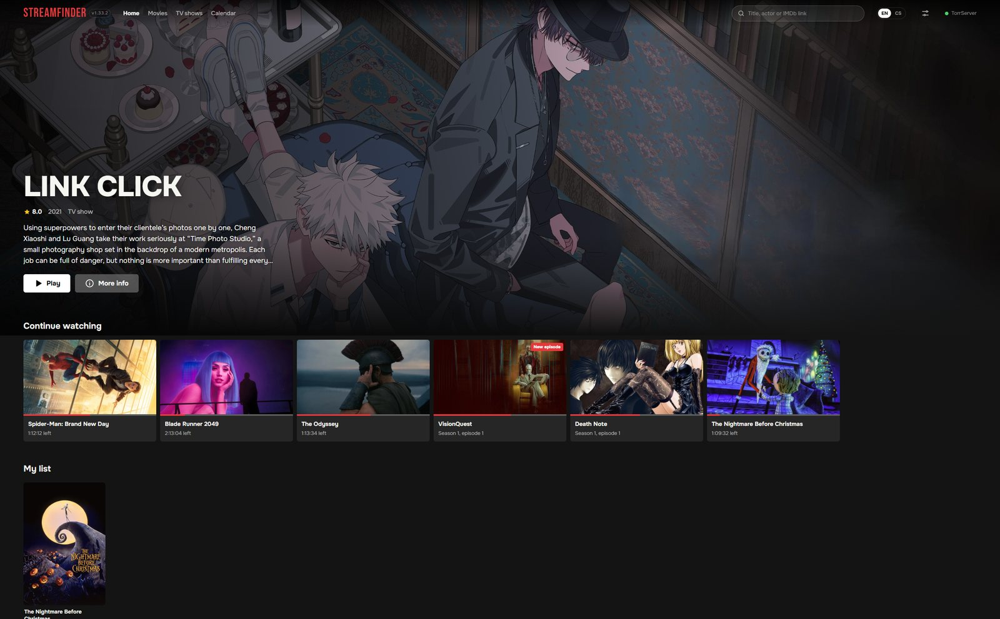
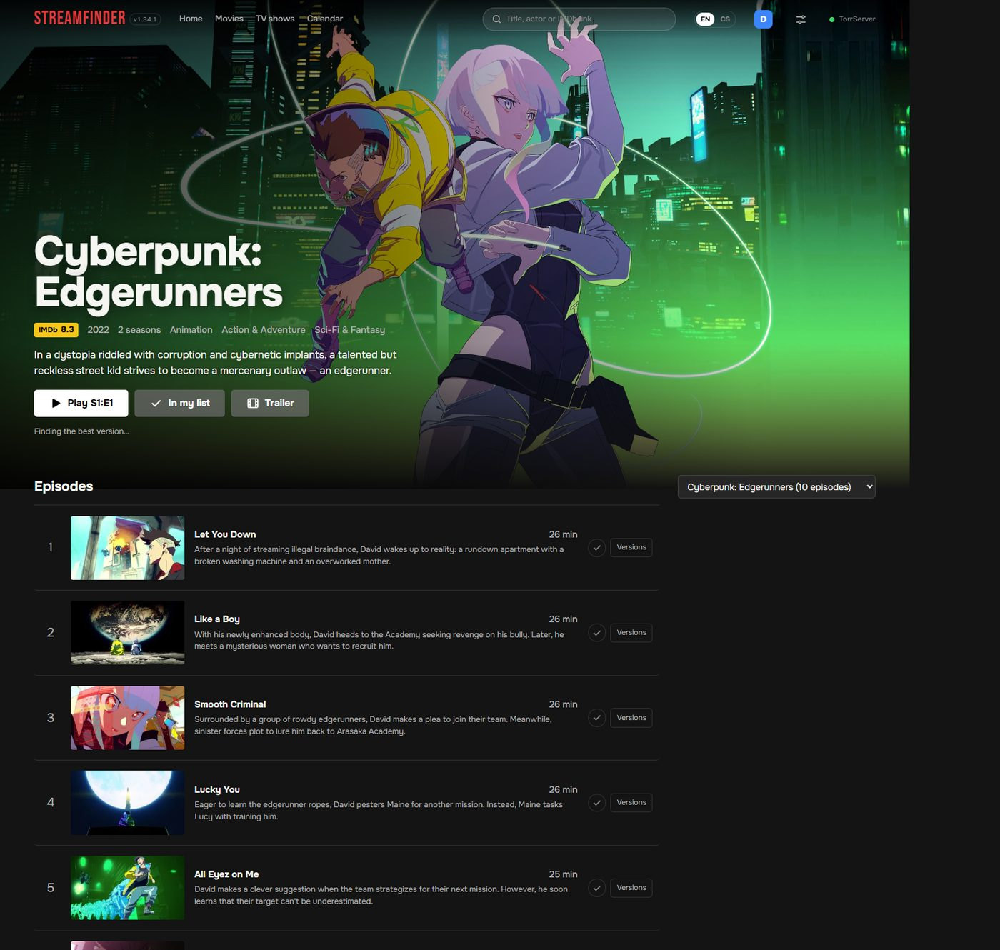
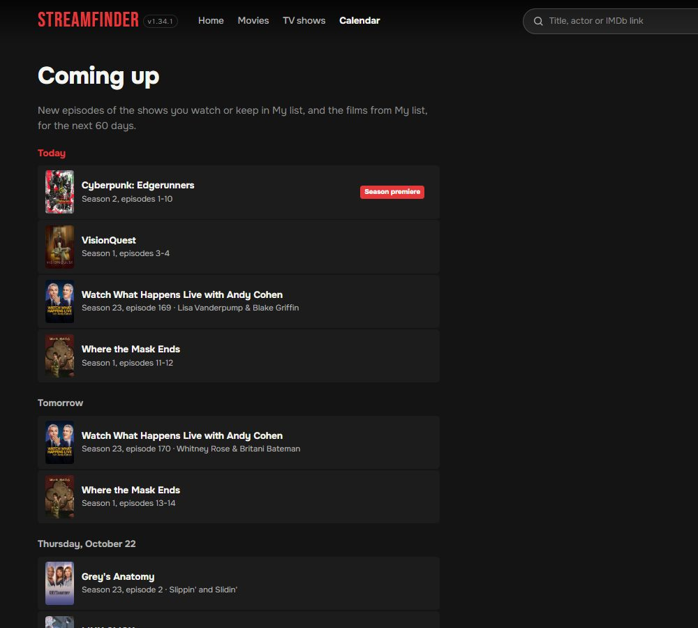
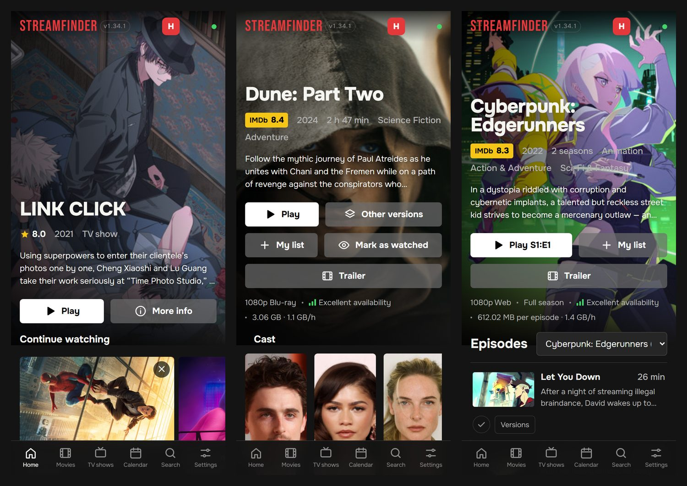

# StreamFinder

Your own Netflix-style front end for torrents. Browse movies and shows, press
**Play**, and StreamFinder finds a good torrent, streams it through
[TorrServer](https://github.com/YouROK/TorrServer) and loads subtitles that are in
sync. Works on a PC, a Raspberry Pi or an Android phone; you watch in any browser
on your network (TV, phone, laptop). English and Czech.



<sub>[The whole home page](images/home-full.jpg)</sub>

What it does for you:

- searches YTS, EZTV, The Pirate Bay, Knaben, Torrents-CSV and SkTorrent at once and
  picks the release that will actually play: the right film (remakes and same-name
  shows told apart by year and IMDb id), the right episode, a sensible size, no cam
  rips, no AI upscales - or the smallest good one with *Data saver*
- Czech dubbing and Czech subtitles first, if you want them
- converts audio browsers can't play (AC3, DTS) on the fly
- subtitles from the torrent and OpenSubtitles, synced exactly to the speech (you
  see it listening and matching), machine translated when your language is
  missing, or written live from the audio by Whisper (AI subtitles)
- the next episode is already loading while you watch, and the subtitles and audio
  you picked stay for the rest of the show
- switches to a faster source by itself when one stalls
- profiles: everyone in the house has their own *Continue watching* and *My list*,
  on every device
- a Calendar of new episodes and of the day films become watchable, and a message
  to your phone (ntfy or Telegram) when a new episode can actually be played
- updates itself from GitHub

| | |
|---|---|
|  |  |
| A film: versions, My list, watched, its collection | A show: episodes, watched ticks, versions per episode |
|  |  |
| Calendar: what comes out for the titles you follow | On a phone |

Only use it for content you are allowed to watch.

## Install

You need one free key, from TMDB (the movie catalogue) - see [API keys](#api-keys).
The installers ask for it (the Windows app on its first start, in the browser); you
can also skip it and enter it later in Settings.

### Windows 10 / 11

Download **StreamFinder-x.y.z-windows.zip** from the
[latest release](https://github.com/poruto/stream-finder-torrent/releases/latest),
unzip it anywhere (Documents, a USB stick - not Program Files) and run
**StreamFinder.exe**. Nothing to install: Python, TorrServer and Whisper are in the
folder, and so are your settings. Windows may warn about an unknown app: *More
info → Run anyway*.

StreamFinder opens in its own window, like an installed app (Edge or Chrome in app
mode - no address bar, its own taskbar entry), and sits in the tray (bottom right). Right-click
the icon for *Start with Windows*, *Check for updates* and *Quit*. It also checks
for new versions by itself every 30 minutes. When Windows asks whether TorrServer
and Python may use the network, allow it (private networks) so your TV and phone
can connect.

Prefer a git checkout? In PowerShell:

```powershell
irm https://raw.githubusercontent.com/poruto/stream-finder-torrent/master/windows-install.ps1 | iex
```

That one starts with Windows, follows `master` and adds the `streamfinder start |
stop | restart | status | update | logs` command.

### Raspberry Pi or a Linux server (Docker)

```sh
curl -fsSL https://raw.githubusercontent.com/poruto/stream-finder-torrent/master/install.sh | bash
```

Installs Docker if needed, asks for the keys, starts StreamFinder and TorrServer and
checks GitHub every 5 minutes for a new version (it pulls the ready-made image, so a
Pi doesn't have to build anything). Update by hand with `./update.sh`. A Raspberry Pi
3 is too slow for local Whisper - use a Groq key there for AI subtitles.

Already have Docker and just want the containers:

```sh
git clone https://github.com/poruto/stream-finder-torrent && cd stream-finder-torrent
cp .env.example .env    # put your TMDB key in
./docker-up.sh
```

### Android phone (Termux)

Install [Termux from F-Droid](https://f-droid.org/packages/com.termux/) (not the Play
Store version), open it and run:

```sh
curl -fsSL https://raw.githubusercontent.com/poruto/stream-finder-torrent/master/termux-install.sh | bash
```

It runs as a service, restarts after crashes and updates itself every 30 minutes.
For autostart after a reboot install
[Termux:Boot](https://f-droid.org/packages/com.termux.boot/) and open it once, and
turn off battery optimisation for Termux. Commands:
`streamfinder start | stop | restart | status | update | logs`.

## Open it

- on the same machine: <http://127.0.0.1:5000>
- from other devices: `http://<ip of that machine>:5000` (the installers print it)

Settings (gear icon) has your playback options. **Server settings** at the bottom
need the admin login - `admin` / `admin` until you change it there. All keys can be
entered or changed there at any time.

### Good to know

- **Slow or metered internet:** Settings → Quality → *Data saver* picks the smallest
  version that still looks good (often HEVC at about 1 GB per hour). In Server
  settings you can also limit or switch off uploading and download less ahead.
- **Phone notifications:** install the free [ntfy](https://ntfy.sh) app, subscribe
  to a topic only you know (e.g. `novakovi-filmy-7x2`) and put
  `https://ntfy.sh/novakovi-filmy-7x2` into Server settings → *New-episode
  notifications*. Tap *Send a test*. A Telegram bot works too.
- **Profiles:** the letter in the top right corner. Add one per person; each device
  remembers who is watching.
- **Storage:** on a Raspberry Pi, *Service status* → *Storage* shows what TorrServer
  keeps and lets you clean up.

## API keys

**TMDB** - required, free. Movie and show catalogue, posters, search.

1. Create an account at [themoviedb.org](https://www.themoviedb.org/signup) and
   confirm the e-mail.
2. Open [Settings → API](https://www.themoviedb.org/settings/api) and click
   _Create_ (or _Request an API key_), choose _Developer_, accept the terms.
3. Fill in the short form. For a personal app anything sensible works: name
   "StreamFinder", URL `http://localhost`, "personal media browser".
4. Copy the **API Key** (the short one). Not the long _Read Access Token_.

**OpenSubtitles** - optional, free. Exact subtitle matches by file hash. Subtitles
work without it too (OpenSubtitles.org and the torrent itself).

1. Register at [opensubtitles.com](https://www.opensubtitles.com/en/users/sign_up).
2. Go to [API consumers](https://www.opensubtitles.com/consumers), click _New
   consumer_, give it a name and copy the API key.
3. Optionally also enter your OpenSubtitles username and password in Settings:
   5 downloads a day become 20.

**SkTorrent** - optional, free. Czech and Slovak films and series with dubbing.
Register at [sktorrent.eu](https://sktorrent.eu) and enter the username and
password.

**Groq** - optional, free, no card. Faster AI subtitles and better translations
than the local Whisper.

1. Sign in at [console.groq.com](https://console.groq.com) (Google or GitHub
   account is fine).
2. Open [API Keys](https://console.groq.com/keys), click _Create API Key_ and copy
   it right away - it is shown only once.

AI subtitles are off until you switch them on in Server settings. The installers set
up a local Whisper (offline, free) on PCs and phones; a Groq key is the faster
alternative.

## Updates and versions

Every push to `master` is a new version, numbered from the commit messages
(`feat:` → 1.**16**.0, anything else → 1.15.**2**). The number is in the top left
corner of the app. Installs check for new versions by themselves: the Pi every
5 minutes, phones and Windows every 30 minutes. Each version also gets a GitHub
release with the portable Windows app and a Docker image
(`ghcr.io/poruto/stream-finder-torrent`).

## Development

```sh
pip install -r requirements.txt      # on Windows/macOS this brings ffmpeg too
cp .env.example .env                 # TMDB_API_KEY at least
./torr/TorrServer-windows-amd64.exe  # or any TorrServer on port 8090
python app.py                        # http://127.0.0.1:5000
python -m pytest tests
```

The tests include headless browser tests (Playwright). They are skipped until you
install the dev tools once:

```sh
pip install -r requirements-dev.txt
python -m playwright install chromium
```

All server settings are in `.env` (see `.env.example`). Viewer settings (quality,
subtitle languages, playback) live in each browser.

```
app.py                  entry point (python app.py, gunicorn/waitress app:app)
streamfinder/
  views.py, api.py      pages and JSON API
  matching.py           release-name parsing and scoring
  torrents/             index providers, ranking, picking
  torrserver.py         TorrServer client
  transcode.py          ffmpeg: probing, audio conversion, speech detection
  subtitles/            sources, sync, translation, AI subtitles, Whisper models
  tmdb.py, imdb.py      metadata and ratings
  i18n.py               English and Czech texts
  version.py            version from the commit history
windows/                Windows tray app and service (control.py, launcher.cs, build-release.ps1)
install.sh, update.sh   Docker install on Linux; docker-up.sh starts the containers
termux-install.sh       Android
install-whisper.sh      local Whisper on Linux/Termux
```

---

Created by [PoruTo](https://github.com/poruto).
